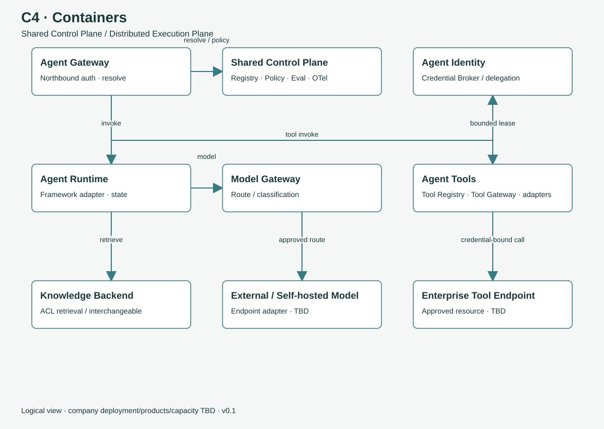

# 플랫폼 아키텍처와 주요 구성요소

> 개발자 가이드 문서입니다. 규범은 [아키텍처](../architecture.md) 기술 표준 문서가 기준입니다.

주요 용어 [Shared Control Plane](09-glossary.md#term-control-plane) [Distributed Execution Plane](09-glossary.md#term-execution-plane) [Agent Gateway](09-glossary.md#term-agent-gateway) [Model Gateway](09-glossary.md#term-model-gateway) [Tool Gateway](09-glossary.md#term-tool-gateway) [Credential Broker](09-glossary.md#term-credential-broker)

**{{icon:target}} 학습 목표**

- 공통 제어 평면과 분산 실행 평면의 책임을 구분할 수 있습니다.
- 주요 구성요소 9개의 역할과 소속을 설명할 수 있습니다.
- 세 Gateway가 담당하는 경계와 방향을 설명할 수 있습니다.
- 플랫폼의 설계 원칙 21개를 영역별로 파악할 수 있습니다.

## 배경

{{icon:question}} 문제 정의 전사 통제를 적용하기 위해 모든 Agent를 단일 위치에서 실행해야 하는지 검토가 필요합니다.

{{icon:eye}} 현황 Agent는 개발자 PC, Mac mini, 사내 서버, 클라우드 등 이기종 환경에서 실행됩니다. 실행 위치를 일원화하면 개발 속도가 저하되고 기존 자원을 활용하기 어렵습니다.

{{icon:bulb}} 설계 방향 **통제는 공통 제어 평면에, 실행은 분산 실행 평면에** 둡니다. 실행 위치와 관계없이 동일한 계약을 준수하면 동일한 규칙으로 통제됩니다.

## 공통 제어 평면과 분산 실행 평면

<b class="title">{{icon:control}} Shared Control Plane</b>
전사 공통으로 운영하는 제어 영역
<ul><li>{{icon:manifest}} Registry</li><li>{{icon:shield}} Policy</li><li>{{icon:identity}} Identity 중개</li><li>{{icon:test}} Evaluation</li><li>{{icon:eye}} Observability</li><li>{{icon:rocket}} Promotion</li></ul>

<b>&#8596;</b>공통 계약 workload identity

<b class="title">{{icon:runtime}} Distributed Execution Plane</b>
Agent가 실행되는 환경
<ul><li>{{icon:laptop}} 개발자 PC</li><li>{{icon:server}} Mac mini · 워크스테이션</li><li>{{icon:server}} 사내 서버</li><li>{{icon:cloud}} 클라우드</li></ul>

공통 제어 평면은 Agent를 직접 실행하지 않습니다. 실행 허가, 정책, 기록을 담당하며, 실행은 각 환경에서 수행됩니다. 분산 실행 환경은 workload identity와 아웃바운드 신뢰 채널로 공통 제어 평면에 연결됩니다.

**{{icon:warn}} 등록과 승인의 구분** 실행 환경의 **등록(registered)**은 **프로덕션 승인(production-approved)**과 다릅니다. 개발자 PC도 등록할 수 있으나, 업무 트래픽을 처리하려면 별도의 승인 요건을 충족해야 합니다.

## 주요 구성요소

{{icon:gateway}}<b>Agent Gateway</b>
클라이언트가 Agent를 호출하는 진입점입니다. 인증, Agent 해석, 테넌트 인가, 멱등성(Idempotency) 처리를 담당합니다.
Northbound 진입 경계

{{icon:runtime}}<b>Agent Runtime</b>
framework adapter로 Agent를 실행하고 Identity·Model·Tools·Knowledge·State·Policy 서비스를 소비합니다.
실행·오케스트레이션

{{icon:model}}<b>Model Gateway</b>
논리 모델 이름을 데이터 분류·지역·비용·가용성 정책에 맞는 endpoint로 라우팅합니다.
모델·데이터 반출 경계

{{icon:tools}}<b>Agent Tools</b>
Tool Registry, Tool Gateway, REST/OpenAPI/MCP adapter, 도구 정책과 감사를 포함하는 논리 영역입니다.
도구 연계 영역

{{icon:gateway}}<b>Tool Gateway</b>
도구 ID를 승인된 endpoint로 해석하고 입출력 스키마와 정책을 검증합니다.
소속: Agent Tools

{{icon:identity}}<b>Agent Identity</b>
사용자 Identity, Agent(workload) Identity, 위임 관계, 자격증명 중개를 다루는 논리 영역입니다.
실행 주체 식별 영역

{{icon:key}}<b>Credential Broker</b>
대상·범위·만료가 제한된 단기 자격증명(Credential)을 발급합니다. Runtime과 LLM에는 노출하지 않습니다.
소속: Agent Identity

{{icon:knowledge}}<b>Knowledge(RAG) Backend</b>
RAG 검색 대상 지식 저장소입니다. 공통 RAG 계약을 준수하면 교체할 수 있습니다.
교체 가능한 백엔드

{{icon:control}}<b>Shared Control Plane</b>
Registry, Policy, Identity 중개, Evaluation, Observability, Promotion을 제공합니다.
전사 공통 제어

**{{icon:bulb}} 구성요소 소속** **Tool Gateway는 Agent Tools에**, **Credential Broker는 Agent Identity에** 속합니다. 논리적 소속이므로 물리적으로 통합 배포할 수 있으나, Identity와 데이터 반출(egress)의 신뢰 경계는 통합 배포 시에도 유지해야 합니다(MUST).

C4 Container 도식입니다.

## Gateway별 담당 경계

세 Gateway는 서로 다른 방향의 신뢰 경계를 담당합니다.

{{icon:user}} 사용자 · 업무 앱
<i>&#8594;</i>
{{icon:gateway}}Agent Gateway<small>진입: Identity 위조, 미인가 접근, 중복 실행 차단</small>
<i>&#8594;</i>
{{icon:runtime}} Agent Runtime

{{icon:runtime}} Agent Runtime
<i>&#8594;</i>
{{icon:model}}Model Gateway<small>반출: 분류 위반 외부 전송, 공급사 종속 차단</small>
<i>&#8594;</i>
{{icon:cloud}} 외부 · 자체 호스팅 모델

{{icon:runtime}} Agent Runtime
<i>&#8594;</i>
{{icon:tools}}Tool Gateway<small>반출: 미승인 호출, 자격증명 유출, 비신뢰 결과 차단</small>
<i>&#8594;</i>
{{icon:server}} 사내 · 외부 도구

호출 통제와 모델 공급사 추상화는 서로 다른 책임이므로 Agent Gateway와 Model Gateway를 분리합니다. 세 Gateway는 **논리적 책임 구분**이며, 특정 제품이나 프로세스 수를 의미하지 않습니다.

## 플랫폼 설계 원칙

| 영역 | 원칙 | 관련 문서 |
|---|---|---|
| {{icon:target}} 범위 | 전사 공통 플랫폼 하나를 운영하며, 팀별 중복 구축을 지양합니다 | [도입 배경](01-why.md) |
| {{icon:cloud}} 인프라 | 온프레미스와 퍼블릭 클라우드를 함께 사용하는 Hybrid Cloud를 전제하며, 실행 자원은 특정 서빙 제품에 종속되지 않습니다 | 이 문서 |
| {{icon:control}} 구조 | 통제는 Shared Control Plane에, 실행은 Distributed Execution Plane에 둡니다 | 이 문서 |
| {{icon:gateway}} 호출 경계 | Agent Gateway, Model Gateway, Tool Gateway는 서로 다른 경계를 담당합니다 | 이 문서 |
| {{icon:model}} 모델 | 외부 상용 LLM과 자체 호스팅 오픈소스 모델을 함께 사용하며, Model Gateway가 정책에 따라 경로를 선택합니다 | [요청 처리 흐름](03-one-request.md) |
| {{icon:runtime}} 실행 | 공통 Runtime 계약과 framework adapter로 프레임워크와 무관하게 실행합니다 | [요청 처리 흐름](03-one-request.md) |
| {{icon:tools}} 도구 | REST/OpenAPI, MCP, 사용자 정의 adapter를 Tool Gateway에서 지원합니다 | [요청 처리 흐름](03-one-request.md) |
| {{icon:identity}} Identity | 사용자 Identity와 Agent Identity를 함께 다루며, 자격증명은 Credential Broker가 단기로 발급합니다 | [신뢰 경계](04-trust.md) |
| {{icon:lock}} 테넌트 | 논리 격리를 기본으로 하며, 민감도와 위험도에 따라 물리 분리를 적용합니다 | [신뢰 경계](04-trust.md) |
| {{icon:shield}} 데이터 | 데이터 분류에 따라 접근과 이동(외부 모델 전송 포함)을 통제합니다 | [신뢰 경계](04-trust.md) |
| {{icon:agent}} Agent 유형 | RAG, Tool, Workflow, Multi-Agent를 공통 계약 수준에서 지원합니다 | [Agent 유형과 Manifest](05-agents-and-manifest.md) |
| {{icon:knowledge}} 지식 | 공통 RAG 계약을 준수하면 검색 백엔드를 교체할 수 있습니다 | [Agent 유형과 Manifest](05-agents-and-manifest.md) |
| {{icon:agents}} Agent 간 통신 | 공통 Agent 통신 계약을 사용하며, A2A 등 특정 프로토콜은 선택 사항입니다 | [Agent 유형과 Manifest](05-agents-and-manifest.md) |
| {{icon:laptop}} 개발 방식 | Local-First, CLI-First 방식으로 기존 IDE·Git·CLI를 유지하며, 중앙 소스 업로드를 강제하지 않습니다 | [수명주기](06-lifecycle.md) |
| {{icon:test}} 실험 | 실험은 로컬에서 수행하고, 공유가 필요한 경우 공용 실험·평가 레지스트리에 기록합니다 | [수명주기](06-lifecycle.md) |
| {{icon:approve}} 수명주기 | 자동 게이트를 통과하면 셀프서비스로 진행하며, 위험도가 높을수록 사람의 승인을 추가합니다 | [수명주기](06-lifecycle.md) |
| {{icon:eye}} 품질 | 관측성, 자동 평가, 품질 게이트를 배포 과정에 포함합니다 | [수명주기](06-lifecycle.md) |
| {{icon:clock}} 신뢰성 | 장시간 작업은 Durable 실행, HITL 승인, 정책 통제로 처리합니다 | [수명주기](06-lifecycle.md) |
| {{icon:target}} 운영 목표 | SLO는 실행 환경과 업무 위험도에 따라 단계적으로 정의합니다 | [수명주기](06-lifecycle.md) |
| {{icon:rocket}} 도입 방식 | 종단 간 실행 경로 하나를 먼저 완성하고, 기능을 단계적으로 추가합니다 | [수명주기](06-lifecycle.md) |
| {{icon:code}} 계약 | API 계약과 JSON Schema는 언어 중립적이며, 코드로 검증하고 버전으로 관리합니다 | [기술 표준 해석](08-reading-the-spec.md) |

**{{icon:question}} 이해도 점검**

Q1. 개발자 PC를 실행 환경으로 등록하면 업무 트래픽을 처리할 수 있습니까?

처리할 수 없습니다. 등록(registered)과 프로덕션 승인(production-approved)은 다르며, 승인에는 보안 검토·평가 결과·롤백 검증 등의 요건이 필요합니다.

Q2. Credential Broker는 어느 영역에 속합니까?

Agent Identity에 속합니다. Tool Gateway는 Agent Tools에 속합니다.

Q3. Model Gateway가 차단하는 위험은 무엇입니까?

데이터 분류에 맞지 않는 외부 모델 전송과, Agent 코드가 특정 모델 공급사에 종속되는 것입니다.

**요약**

- 통제는 Shared Control Plane에, 실행은 Distributed Execution Plane에 둡니다.
- 주요 구성요소는 9개이며, Tool Gateway는 Agent Tools에, Credential Broker는 Agent Identity에 속합니다.
- 세 Gateway는 진입 경계 하나와 반출 경계 두 개를 각각 담당합니다.

<nav class="pager"><a href="01-why.md"><small>이전</small><b>플랫폼 도입 배경과 설계 원칙</b></a><a class="next" href="03-one-request.md"><small>다음</small><b>Agent 요청 처리 흐름</b></a></nav>
