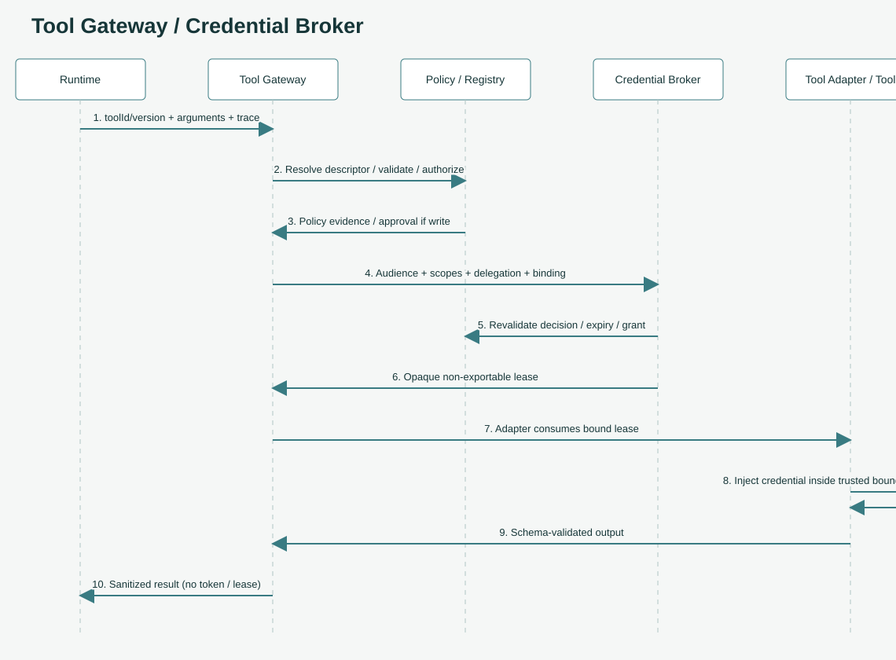
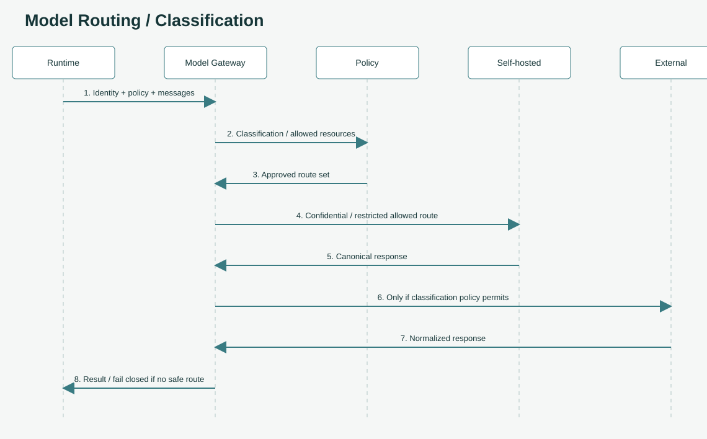

# 요청 하나 따라가기

> 온보딩 안내서입니다. 규범은 [아키텍처](../architecture.md), [Agent Tools](../agent-tools.md), [Agent Identity](../identity-and-credentials.md) 정의 문서가 기준입니다.

<div class="terms" markdown="1">
<span class="label">핵심 용어</span> [Idempotency-Key](09-glossary.md#term-idempotency) [identity context](09-glossary.md#term-identity-context) [Lease](09-glossary.md#term-lease) [routeDecisionId](09-glossary.md#term-route-decision) [traceparent](09-glossary.md#term-trace) [Problem Details](09-glossary.md#term-problem)
</div>

<div class="goals" markdown="1">
**{{icon:target}} 이 페이지에서 배울 것**

- 요청 하나가 플랫폼을 지나가는 다섯 단계
- 각 단계에서 무엇을 검사하고 무엇을 믿지 않는지
- Agent가 도구를 부를 때 자격증명이 LLM에 닿지 않는 이유
</div>

## 들어가며

<div class="opener" markdown="1">
<span class="tag">{{icon:question}} 질문</span> "청구서 INV-2048 요약해 줘" 한마디가 답이 되기까지 어떤 일이 일어날까요?

<span class="tag">{{icon:eye}} 관찰</span> 이 Agent는 사내 ERP에서 청구서를 조회하고(도구), 모델로 요약합니다. 데이터는 기밀(`confidential`)입니다. 사용자 확인, 도구 권한, 데이터 반출이 한 요청 안에 모두 걸려 있습니다.

<span class="tag">{{icon:bulb}} 해결책</span> 각 관문이 **자기 경계에서 한 가지씩** 책임지게 나눕니다. 그래서 어느 한 곳이 뚫려도 나머지가 막습니다.
</div>

## 전체 흐름

<ol class="flow">
<li>{{icon:gateway}}<b>1. 들어오기</b><span>Agent Gateway<br>인증 · 찾기 · 권한 · 중복</span></li>
<li>{{icon:runtime}}<b>2. 실행</b><span>Agent Runtime<br>adapter로 Agent 호출</span></li>
<li>{{icon:tools}}<b>3. 도구</b><span>Tool Gateway + Broker<br>짧은 자격증명</span></li>
<li>{{icon:model}}<b>4. 모델</b><span>Model Gateway<br>분류에 맞는 경로</span></li>
<li>{{icon:trace}}<b>5. 기록</b><span>Observability<br>trace는 끝까지</span></li>
</ol>

## 1단계. 정문을 통과한다

앱은 Agent Gateway에 HTTP 요청을 보냅니다.

```text
POST /v1/agents/{agentId}/invocations
Authorization: Bearer <회사 IdP가 발급한 access token>
traceparent: 00-<trace-id>-<span-id>-01
Idempotency-Key: <같은 요청 재전송을 알아보는 키>
```

```json
{
  "input": {"type": "message", "content": "청구서 INV-2048 요약해 줘"},
  "context": {"tenantId": "finance", "dataClassification": "confidential"},
  "execution": {"mode": "sync", "timeoutMs": 30000}
}
```

<div class="cards">
<div class="card">{{icon:lock}}<b>인증</b><p>토큰의 발급자, 대상(audience), 서명, 만료를 검증합니다.</p></div>
<div class="card">{{icon:manifest}}<b>Agent 찾기</b><p>Registry에서 Git revision과 artifact digest가 고정된 <b>불변 버전</b>을 찾습니다.</p></div>
<div class="card">{{icon:user}}<b>테넌트 권한</b><p>이 사용자가 이 테넌트의 이 Agent를 불러도 되는지 확인합니다.</p></div>
<div class="card">{{icon:check}}<b>중복 방지</b><p>같은 키로 다른 내용이 오면 거부하고, 같은 요청이면 저장된 결과를 돌려줍니다.</p></div>
</div>

<div class="compare" markdown="1">
<div class="bad" markdown="1">
**{{icon:cross}} 믿지 않는 것**

body의 `tenantId`, `"role": "admin"` 같은 값. 요청 본문에 적는다고 권한이 생기지 않습니다.
</div>
<div class="good" markdown="1">
**{{icon:check}} 믿는 것**

검증된 토큰에서 꺼낸 신원과 테넌트. body의 값은 토큰 값과 **비교하는 용도로만** 씁니다.
</div>
</div>

## 2단계. Agent가 실행된다

Gateway는 Runtime에 실행을 맡기면서 Agent 버전, **검증된 신원 정보(identity context)**, **정책 정보(policy context)**를 함께 넘깁니다.

Runtime은 Manifest에 적힌 framework adapter로 Agent 코드를 부릅니다. LangGraph로 만든 Agent든 직접 짠 Agent든 Runtime에는 같은 계약으로 보입니다. 그래서 프레임워크를 바꿔도 플랫폼 쪽은 바뀌지 않습니다.

<div class="point" markdown="1">
**{{icon:bulb}} 핵심 포인트** Runtime은 보안·정책 권한을 스스로 바꿀 수 없습니다(MUST NOT). 받은 권한 안에서만 일합니다.
</div>

## 3단계. 도구를 부른다

Agent가 ERP에서 청구서를 조회해야 합니다. 이 플랫폼에서 가장 신경 쓴 부분입니다. 각 구간이 **무엇을 손에 쥐고 있는지** 보세요.

<ol class="flow">
<li>{{icon:runtime}}<b>Runtime</b><span>도구 ID · 버전 · 인자만<br><strong>토큰 없음</strong></span></li>
<li>{{icon:gateway}}<b>Tool Gateway</b><span>승인된 endpoint 확인<br>입력 스키마 · 정책 · 승인</span></li>
<li class="hi">{{icon:key}}<b>Credential Broker</b><span>정책 증거 재확인 후<br>이 호출에만 묶인 lease</span></li>
<li>{{icon:tools}}<b>Tool adapter</b><span>신뢰 경계 안에서만<br>lease를 실제 자격증명으로</span></li>
<li>{{icon:server}}<b>ERP</b><span>결과를 스키마·분류 검사 후<br>Runtime에 돌려줌</span></li>
</ol>

1. Runtime은 Tool Gateway에 **도구 ID와 버전, 인자**만 보냅니다. URL이나 토큰은 보내지 않고, 보낼 수도 없습니다.
2. Tool Gateway는 Tool Registry에서 **승인된 endpoint**를 찾고, 입력 스키마와 정책을 검사합니다. 쓰기(write) 작업이면 유효한 승인도 확인합니다.
3. Credential Broker에 요청하는 범위는 **사용자 권한 ∩ Agent 권한 ∩ 도구 허용 범위 ∩ 정책**을 넘을 수 없습니다.
4. Broker는 토큰 원문이 아니라 **짧게 살고 이 호출에만 묶인 불투명한 lease**를 줍니다.
5. 결과는 출력 스키마와 데이터 분류를 검사하고, 감사 기록과 민감정보 가림을 거쳐 돌아옵니다. 결과에는 토큰도 lease도 들어가지 않습니다.

<div class="compare" markdown="1">
<div class="bad" markdown="1">
**{{icon:cross}} 이렇게 하지 않습니다**

```text
Runtime → 저장된 API 키 조회 → LLM·도구 코드 → ERP
```

LLM이 키를 보는 순간, 프롬프트 인젝션 한 줄로 유출될 수 있습니다.
</div>
<div class="good" markdown="1">
**{{icon:check}} 이렇게 합니다**

```text
Runtime → Tool Gateway → Credential Broker
→ 짧은 lease → adapter → ERP
```

LLM은 자격증명을 본 적이 없으니 유출할 것도 없습니다.
</div>
</div>

정식 순서도입니다.



## 4단계. 모델을 부른다

Agent는 특정 공급사의 모델을 직접 부르지 않고, Model Gateway에 **논리 모델 이름**과 **정책 정보**를 보냅니다.

<div class="lanes">
<div class="lane"><div>{{icon:shield}} <code>public</code> · <code>internal</code></div><i>&#8594;</i><div class="gate">{{icon:model}}<span>Model Gateway<small>정책이 허용하면</small></span></div><i>&#8594;</i><div>{{icon:cloud}} 외부 또는 자체 호스팅 모델</div></div>
<div class="lane"><div>{{icon:lock}} <code>confidential</code> · <code>restricted</code></div><i>&#8594;</i><div class="gate">{{icon:model}}<span>Model Gateway<small>외부 경로 거부</small></span></div><i>&#8594;</i><div>{{icon:server}} 자체 호스팅 모델만</div></div>
<div class="lane"><div>{{icon:warn}} 안전한 경로 없음</div><i>&#8594;</i><div class="gate">{{icon:model}}<span>Model Gateway<small>우회하지 않음</small></span></div><i>&#8594;</i><div>{{icon:cross}} 요청 실패</div></div>
</div>

이 예시의 데이터는 `confidential`이라 사내 모델로 갑니다. 응답에는 어떤 경로로 갔는지 기록하는 `routeDecisionId`가 붙습니다.



## 5단계. 기록하고 돌려준다

처음 요청에 붙어 온 `traceparent`는 Gateway → Runtime → Tool Gateway → Model Gateway까지 그대로 전달됩니다. 나중에 이 요청 하나가 어디를 거쳤는지 한 줄로 볼 수 있습니다.

<div class="compare" markdown="1">
<div class="good" markdown="1">
**{{icon:check}} 기록하는 것**

테넌트 별칭, 호출 ID, adapter, 정책 결정, 오류 종류
</div>
<div class="bad" markdown="1">
**{{icon:cross}} 기록하지 않는 것**

프롬프트 원문, 토큰, 검색된 개인정보 원문
</div>
</div>

최종 응답은 이런 모양입니다. 이 패키지의 로컬 mock을 실제로 실행한 결과입니다.

```json
{
  "invocationId": "inv-79b4fa3420244ae4bccb3b4a3473dea6",
  "agentVersion": "0.1.0",
  "status": "succeeded",
  "output": {"type": "message", "content": "mock:hello"},
  "traceparent": "00-1b0f13dcfd2f426a87937b2bb6d7f852-ac2cb29d6d8f4c46-01",
  "routeDecisionId": "route-self-hosted",
  "usage": {"inputTokens": 1, "outputTokens": 1}
}
```

오류는 RFC 9457 Problem Details(`application/problem+json`) 형식으로 돌아옵니다.

<div class="check" markdown="1">
**{{icon:question}} 스스로 점검**

<details markdown="1"><summary>Q1. 요청 body에 다른 팀의 tenantId를 넣으면 그 팀 데이터에 접근할 수 있나요?</summary>
아닙니다. 테넌트는 검증된 토큰에서 꺼내고, body의 값은 비교용입니다. 서로 다르면 거부됩니다.
</details>

<details markdown="1"><summary>Q2. Runtime이 Tool Gateway에 보내는 것은 무엇인가요?</summary>
도구 ID, 버전, 인자입니다. URL과 토큰은 보내지 않습니다. 실제 endpoint와 자격증명은 Tool Gateway와 Credential Broker가 정합니다.
</details>

<details markdown="1"><summary>Q3. confidential 데이터인데 사내 모델이 모두 내려가 있으면 어떻게 되나요?</summary>
요청이 실패합니다. 안전한 경로가 없을 때 외부 모델로 우회하지 않습니다.
</details>
</div>

<div class="summary" markdown="1">
**정리**

- 들어오기 → 실행 → 도구 → 모델 → 기록, 다섯 단계마다 담당 관문이 한 가지씩 책임집니다.
- 신원은 토큰에서만 꺼내고, 자격증명은 Runtime과 LLM에 노출하지 않습니다.
- 데이터 분류가 모델 경로를 정하고, 안전한 경로가 없으면 실패합니다.
</div>

<nav class="pager"><a href="02-big-picture.md"><small>이전</small><b>한 장으로 보는 전체 구조</b></a><a class="next" href="04-trust.md"><small>다음</small><b>신뢰 경계: 무엇을 믿지 않는가</b></a></nav>
