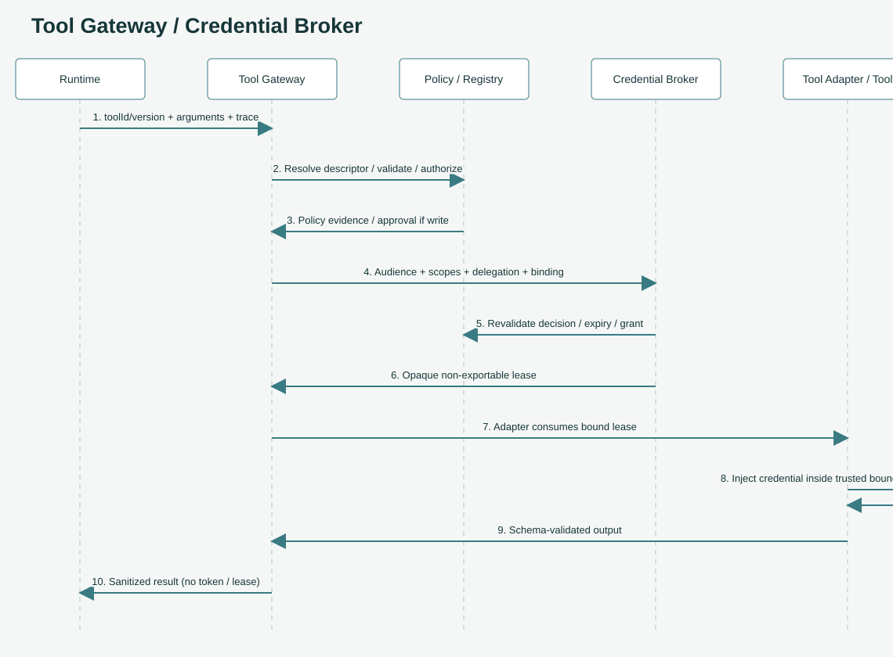

# Agent Platform APIs: 요청 하나 따라가기

> 개발자 가이드 문서입니다. 규범은 [아키텍처](../architecture.md), [Agent Tools](../agent-tools.md), [Agent Identity](../identity-and-credentials.md) 기술 표준 문서가 기준입니다.

{{journey:1}}

<div class="sofar" markdown="1">
**지금까지** [청구서 Agent의 하루](02-big-picture.md)에서 장면 열한 개를 한 번 훑었습니다. 이제 첫 장면부터 하나씩 들여다봅니다. 등장인물은 재무팀 담당자 서연, Agent를 만든 개발자 민준입니다.
</div>

## 장면

서연이 재무팀 업무 앱에 "청구서 INV-2048 요약해 줘"라고 입력합니다(요청 A). 앱은 이 문장을 플랫폼의 정문인 Agent Platform APIs로 보냅니다. 응답이 조금 늦자 앱이 같은 요청을 한 번 더 보냅니다. 그런데 Agent는 한 번만 실행됩니다. 정문이 "이 요청은 이미 받았다"는 것을 알아봤기 때문입니다. 정문은 그 전에 서연이 누구인지부터 확인했습니다.

<div class="point" markdown="1">
**{{icon:bulb}} Agent Platform APIs가 없다면** Agent마다 주소와 인증 방식이 달라지고, 같은 요청이 두 번 오면 두 번 실행됩니다.
</div>

## 무슨 일이 일어나나

요청 하나가 응답이 되기까지 다섯 단계를 지납니다. 이 장은 첫 단계인 정문을 자세히 보고, 나머지 단계는 각 장으로 이어집니다.

<ol class="flow">
<li data-say="정문 단계입니다. 토큰으로 호출자가 누구인지 확인하고(인증), 어떤 Agent를 부르는지 찾고, 그 Agent를 부를 권한이 있는지(인가), 같은 요청이 이미 처리됐는지(멱등성)를 봅니다.">{{icon:gateway}}<b>1. 진입</b><span>Agent Platform APIs<br>인증 · 해석 · 인가 · 멱등성</span></li>
<li data-say="검사를 통과한 요청만 Agent Runtime에 전달됩니다. Runtime은 민준이 만든 Agent 코드를 adapter라는 공통 연결 방식으로 실행합니다.">{{icon:runtime}}<b>2. 실행</b><span>Agent Runtime<br>adapter 기반 Agent 실행</span></li>
<li data-say="Agent가 ERP 같은 도구를 써야 하면 Agent Gateway의 도구 경로에 요청합니다. 실제 접속 정보는 Credential Broker가 그 호출 한 번에만 쓸 수 있게 발급합니다.">{{icon:tools}}<b>3. 도구 호출</b><span>Agent Gateway 도구 경로<br>+ Credential Broker</span></li>
<li data-say="Agent가 모델에게 묻는 단계입니다. 모델 경로가 데이터 분류를 보고 갈 수 있는 모델만 고릅니다. 기밀 데이터는 외부 모델로 보내지 않습니다.">{{icon:model}}<b>4. 모델 호출</b><span>Agent Gateway 모델 경로<br>분류 기반 라우팅</span></li>
<li data-say="처음부터 끝까지 같은 추적 번호로 기록이 남고, 결과가 호출자에게 돌아갑니다. 문제가 생기면 이 기록으로 원인을 찾습니다.">{{icon:trace}}<b>5. 기록</b><span>Agent Observability<br>종단 간 실행 추적</span></li>
</ol>

정문이 하는 일은 넷입니다.

<div class="cards">
<div class="card">{{icon:lock}}<b>인증</b><p>토큰의 발급자, 대상(audience), 서명, 만료를 확인해 서연이 누구인지 정합니다.</p></div>
<div class="card">{{icon:manifest}}<b>Agent 해석</b><p>Registry에서 <code>invoice-summary</code>의 고정된 버전을 찾습니다.</p></div>
<div class="card">{{icon:user}}<b>테넌트 인가</b><p>서연이 재무팀(<code>finance</code>)의 이 Agent를 부를 권한이 있는지 봅니다.</p></div>
<div class="card">{{icon:check}}<b>멱등성 처리</b><p>같은 요청 번호로 같은 내용이 또 오면 저장해 둔 결과를 돌려주고, 다른 내용이 오면 거부합니다.</p></div>
</div>

## 실물 보기

서연의 앱이 보낸 요청입니다.

<!-- kind: example -->

```text
POST /v1/agents/invoice-summary/invocations
Authorization: Bearer <회사 IdP가 발급한 access token>
traceparent: 00-<trace-id>-<span-id>-01
Idempotency-Key: <재전송 요청을 식별하는 키>
```

```json
{
  "input": {"type": "message", "content": "청구서 INV-2048 요약해 줘"},
  "context": {"tenantId": "finance", "dataClassification": "confidential"},
  "execution": {"mode": "sync", "timeoutMs": 30000}
}
```

- `Authorization`: 서연이 누구인지는 여기서만 정해집니다. 본문에 `"role": "admin"`을 적어도 권한이 생기지 않습니다.
- `Idempotency-Key`: 앱이 요청마다 붙이는 번호입니다. 다시 보낼 때 같은 번호를 쓰면 정문이 한 번으로 셉니다.
- `context.tenantId`: 토큰의 테넌트와 **비교하는 데만** 씁니다. 다르면 거부합니다.
- `execution.timeoutMs`: 앱이 기다릴 수 있는 시간입니다. 뒤의 모든 구간이 이 시간 안에서 움직입니다.

서연이 받은 응답과, 같은 문장을 내 PC의 로컬 mock에 보냈을 때의 실제 응답입니다. 필드 구성은 같고 `agentVersion`과 `output.content`가 다릅니다.

<!-- kind: example -->

```json
{
  "invocationId": "inv-…",
  "agentVersion": "1.2.0",
  "status": "succeeded",
  "output": {"type": "message", "content": "한빛상사 2026년 10월분 청구서(INV-2048)입니다. 합계 12,400,000원, 납기 11월 30일입니다."},
  "traceparent": "00-…-…-01",
  "routeDecisionId": "route-self-hosted",
  "usage": {"inputTokens": 412, "outputTokens": 58}
}
```

<!-- kind: run boundary: local -->

```json
{
  "invocationId": "inv-9946215c02f347bd8ba5de71ca079905",
  "agentVersion": "0.1.0",
  "status": "succeeded",
  "output": {"type": "message", "content": "mock:Summarize the invoice: tool:청구서 INV-2048 요약해 줘"},
  "traceparent": "00-d0f1038087eb42d6b187b4c8ba5caa2a-ae9b01ef32f942d6-01",
  "routeDecisionId": "route-self-hosted",
  "usage": {"inputTokens": 7, "outputTokens": 7}
}
```

- `invocationId`: 이 호출의 번호입니다. 문제가 생기면 이 번호로 기록을 찾습니다. 앱은 이 번호를 사용자에게 보여 줍니다.
- `routeDecisionId`: 어느 모델로 갔는지입니다. 기밀이라 회사 안 모델(`route-self-hosted`)로 갔습니다.
- 로컬 mock의 도구와 모델은 받은 글 앞에 `tool:`, `mock:`을 붙여 돌려주는 대역이라 실제 요약은 나오지 않습니다.

## 직접 해 보기

<div class="sim" data-sim="request"></div>

<ol class="mission">
<li>토큰을 빼고 보내 보세요. 어느 단계에서 멈추나요.</li>
<li>하준처럼 권한이 모자란 사용자로 보내면 Agent 코드가 실행되나요.</li>
</ol>

<details class="more" markdown="1"><summary>더 해 보기: 같은 요청을 여러 번 보내기</summary>

<div class="sim" data-sim="idempotency"></div>

<ol class="mission">
<li>같은 키로 같은 요청을 두 번 보내면 Agent는 몇 번 실행되나요.</li>
<li>같은 키에 다른 내용을 실으면 어떻게 되나요.</li>
</ol>
</details>

## 잘못되면

**서연의 앱을 만든 개발자가 토큰을 붙이지 않으면** 401을 받습니다. 정문은 누가 보냈는지 모르는 요청을 안으로 들이지 않습니다. Agent 코드는 한 줄도 실행되지 않습니다. 로그인한 사용자의 토큰을 `Authorization`에 실어 보냅니다.

**요청 본문에 다른 팀의 테넌트를 적으면** 403을 받습니다. 테넌트는 검증된 토큰에서만 정하고 본문의 값은 비교에만 씁니다. 본문을 바꿔 다른 팀의 데이터에 닿을 수 없습니다.

오류는 RFC 9457 Problem Details(`application/problem+json`) 형식으로 옵니다. 로컬 mock이 실제로 돌려주는 403입니다.

<!-- kind: run boundary: local -->

```json
{"type": "about:blank", "title": "FORBIDDEN", "status": 403, "detail": "Tenant assertion does not match authenticated identity", "code": "FORBIDDEN", "traceId": "…"}
```

<details class="more" markdown="1"><summary>더 보기: 권한 부족, 같은 키에 다른 내용, 그리고 비동기 호출</summary>

| 상황 | 응답 | 뜻 |
|---|---|---|
| Agent가 요구하는 권한이 호출자에게 없음 | 403 | Manifest의 `requiredScopes`를 모두 갖지 못했습니다. 코드는 실행되지 않습니다([Agent Identity](16-agent-identity.md)) |
| 같은 `Idempotency-Key`에 다른 내용 | 409 `CONFLICT` | 실수나 재전송 공격일 수 있어 거부합니다 |
| `Idempotency-Key`가 없음 | 422 `VALIDATION_ERROR` | 다시 보내도 안전하도록 키는 필수입니다 |

메일을 보내는 요청 C처럼 오래 걸리는 호출은 `execution.mode`를 `durable`로 보내고 202를 받은 뒤, 상태 조회(`getInvocation`)와 승인 제출(`submitApproval`)로 이어 갑니다. 이 흐름은 계약만 있고 로컬 mock은 501을 돌려줍니다([AI Platform Applications](20-applications.md)).
</details>

## 내가 할 일

1. 호출 코드를 씁니다. 주소는 `POST /v1/agents/{agentId}/invocations` 하나입니다.
2. 요청마다 `Idempotency-Key`를 붙이고, 다시 보낼 때는 같은 키를 씁니다.
3. 응답의 `invocationId`를 사용자에게 보여 주고 기록에 남깁니다.
4. 오류 응답은 상태 코드와 `code`로 처리합니다.

**내 PC에서 해 보기** [로컬 환경 구성 및 호출 실습](07-hands-on.md)의 실습 2가 이 요청을 그대로 보내 봅니다. 이 장의 응답을 그대로 재현하려면 [Agent Tools](15-agent-tools.md)의 명령을 씁니다.

<div class="scope" markdown="1">
**제공 범위 (v0.1)**

| 항목 | 등급 | 확인하는 곳 |
|---|---|---|
| Agent 호출 API(동기), 테넌트 비교, 멱등성, Problem Details | 실행 | 로컬 mock, 적합성 C3~C6 |
| 목록·상태 조회·취소·이벤트·승인 API | 계약 | `contracts/agent-gateway.openapi.json`. 로컬 mock은 501 |
| 회사 IdP의 토큰 검증 | 정의 | 로컬 mock은 고정 토큰 `Bearer mock-user`만 받습니다 |
</div>

## 규칙으로 정리

<div class="compare" markdown="1">
<div class="bad" markdown="1">
**{{icon:cross}} 신뢰하지 않는 값**

요청 본문의 `tenantId`, `"role": "admin"` 등. 요청 본문의 값으로는 권한이 부여되지 않습니다.
</div>
<div class="good" markdown="1">
**{{icon:check}} 신뢰하는 값**

검증된 토큰에서 도출한 Identity와 테넌트. 요청 본문의 값은 토큰 값과의 **비교에만** 사용합니다.
</div>
</div>

- 앱과 외부 솔루션은 Agent Platform APIs로만 들어옵니다(MUST). 장면 ①
- 정문은 Agent 버전, 검증된 실행 주체 정보(identity context), 정책 컨텍스트(policy context)를 Runtime에 넘깁니다. Runtime은 이 권한을 임의로 바꿀 수 없습니다(MUST NOT).
- 같은 키·같은 내용은 저장된 결과를 돌려주고, 같은 키·다른 내용은 409로 거부합니다(MUST). 장면 ①
- `traceparent`는 정문에서 받거나 만들어 뒤의 모든 구간에 전파합니다(MUST).

나머지 네 단계는 각 장에서 자세히 봅니다. 실행은 [Agent Runtime과 Memory](11-runtime-memory.md), 도구 호출은 [Agent Tools](15-agent-tools.md)와 [Agent Identity](16-agent-identity.md), 모델 호출은 [Agent Gateway](17-agent-gateway.md), 기록은 [Agent Observability](12-observability-evaluation.md)입니다. 도구 호출의 구간별 순서는 아래 그림과 같습니다.



<div class="terms" markdown="1">
<span class="label">주요 용어</span> [Agent Platform APIs](09-glossary.md#term-platform-apis) [멱등성 키](09-glossary.md#term-idempotency) [identity context](09-glossary.md#term-identity-context) [routeDecisionId](09-glossary.md#term-route-decision) [traceparent](09-glossary.md#term-trace) [Problem Details](09-glossary.md#term-problem) [테넌트](09-glossary.md#term-tenant)
</div>

## 한 문장으로

모든 요청이 지나는 정문이고, 누가 보냈는지와 같은 요청이 또 왔는지를 여기서 가립니다.

<div class="check" markdown="1">
**{{icon:question}} 이해 점검**

<details markdown="1"><summary>Q1. 서연의 앱이 응답을 기다리다 같은 요청을 한 번 더 보냈습니다. Agent는 몇 번 실행되고 왜 그런가요?</summary>
한 번입니다. 두 요청의 Idempotency-Key와 내용이 같으므로 정문이 저장해 둔 결과를 돌려주고 다시 실행하지 않습니다.
</details>

<details markdown="1"><summary>Q2. 요청 본문에 다른 팀의 tenantId를 적으면 그 팀의 데이터에 접근할 수 있나요?</summary>
없습니다. 테넌트는 검증된 토큰에서 정하고 본문의 값은 비교에만 씁니다. 두 값이 다르면 403입니다.
</details>

<details markdown="1"><summary>Q3. 토큰 없이 보낸 요청에서 Agent 코드는 어디까지 실행되나요?</summary>
한 줄도 실행되지 않습니다. 정문에서 401로 돌려보냅니다.
</details>
</div>

<div class="refs" markdown="1">
**{{icon:book}} 근거와 참고 자료**

- 오류 형식과 토큰 교환: [IETF·OAuth](10-references.md#ref-identity)
- 실행 추적 규격: [OpenTelemetry GenAI](10-references.md#ref-otel)
</div>

다음 장면은 ②입니다. 정문이 찾아낸 `invoice-summary`는 어떻게 거기 등록돼 있었을까요.
