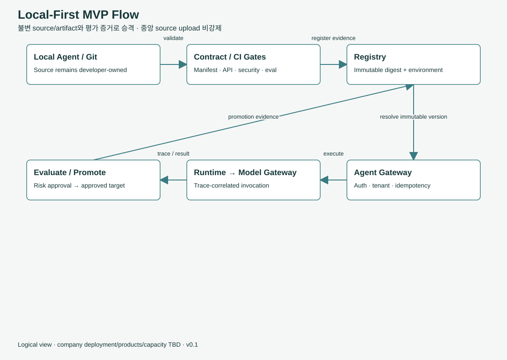

# 내 Agent가 production까지 가는 길

> 온보딩 안내서입니다. 규범은 [운영·평가](../operating-model.md), [배포 프로파일](../deployment.md), [Durable / HITL](../execution.md) 정의 문서가 기준입니다.

핵심 용어 [Local-First](09-glossary.md#term-local-first) [Registry](09-glossary.md#term-registry) [Registered / Production-approved](09-glossary.md#term-approved) [배포 프로파일](09-glossary.md#term-profile) [Durable 실행](09-glossary.md#term-durable) [Contract-as-Code](09-glossary.md#term-contract-as-code)

**{{icon:target}} 이 페이지에서 배울 것**

- 로컬 실험에서 production 승인까지 일곱 단계
- production에 오르려면 필요한 여섯 가지 증거
- 배포 프로파일 세 가지와 실행 상태의 흐름

## 들어가며

{{icon:question}} 질문 내 PC에서 잘 도는 Agent를 언제, 어떻게 실제 업무에 써도 될까요?

{{icon:eye}} 관찰 로컬에서 잘 돈다는 것과 실제 업무 데이터를 맡겨도 된다는 것은 다릅니다. 반대로 처음부터 중앙 절차를 강제하면 실험이 느려집니다.

{{icon:bulb}} 해결책 **개발과 실험은 자유롭게, 승격은 증거로.** 단계마다 필요한 증거가 정해져 있습니다.

## 개발은 지금처럼 한다

**{{icon:cross}} 강제하지 않는 것 (MUST NOT)**

- 중앙 서버에 소스 업로드
- 특정 Agent Studio나 IDE 사용

**{{icon:check}} 플랫폼이 주는 것**

- 계약 기반 SDK, CLI, 템플릿
- 팀 Git 저장소와 평소 쓰는 IDE·CLI 그대로

실험 단계에서 중앙에 등록하는 것은 선택입니다. 등록이 필요해지는 것은 **다른 사람과 같이 시험하거나 production에 올릴 때**입니다.

## 수명주기 일곱 단계

<ol class="flow">
<li>{{icon:laptop}}<b>local experiment</b>내 PC에서 만들고 시험</li>
<li>{{icon:manifest}}<b>registered</b>불변 버전과 Manifest 등록</li>
<li>{{icon:test}}<b>validated</b>스키마·API 계약 통과</li>
<li>{{icon:approve}}<b>eligible</b>평가·검토 후 승격 후보</li>
<li class="hi">{{icon:rocket}}<b>production-approved</b>실제 업무 트래픽 허용</li>
<li>{{icon:clock}}<b>deprecated</b>새로 쓰지 말라고 안내</li>
<li>{{icon:cross}}<b>retired</b>더 이상 실행하지 않음</li>
</ol>

Registry에는 이와 별도로, 문제가 생긴 버전을 막아 두는 **격리(quarantined)** 상태도 있습니다.

## production에 오르려면 필요한 증거 (MUST)

{{icon:lock}}<b>불변 버전과 digest</b>
무엇을 올리는지 바뀌지 않게 고정합니다.

{{icon:test}}<b>스키마·API 적합성</b>
Manifest와 계약 검증을 통과합니다.

{{icon:shield}}<b>보안 검토</b>
신원, 위임, 데이터 이동을 검토합니다.

{{icon:eye}}<b>평가 결과</b>
데이터셋·Agent·Manifest·정책 버전, 지표, 기준, traceId가 묶인 결과

{{icon:clock}}<b>롤백 증거</b>
문제가 생기면 되돌릴 수 있다는 증거

{{icon:approve}}<b>위험별 사람 승인</b>
위험이 높을수록 사람의 승인이 더해집니다.

**{{icon:bulb}} 핵심 포인트** 셀프서비스가 기본입니다. 자동 검사를 통과하면 스스로 진행하고, 위험이 높은 경우에만 사람 승인이 들어갑니다. 코드뿐 아니라 런타임 이미지, 의존성, 도구 설명, 모델 routing 정책이 바뀌어도 다시 평가합니다.

## 어디서 실행하나: 배포 프로파일

{{icon:laptop}}<b>local</b>
개발자 장비. 계약 검증과 합성 데이터 실험용
production 승인 아님

{{icon:server}}<b>shared-experiment</b>
등록된 사내·클라우드 자원. 통합 시험과 평가용
테넌트 격리 · 사용량 한도 · 감사

{{icon:cloud}}<b>production</b>
승인된 hybrid 실행 환경. 실제 업무 트래픽
보안 · 평가 · 복구 · 위험별 SLO 증거

**{{icon:warn}} 주의** 등록된 환경이 곧 production 승인 환경은 아닙니다. 개발자 PC나 Mac mini를 실수로 production처럼 쓰는 것이 이 설계가 경계하는 위험 중 하나입니다. SLO도 실행 환경과 업무 위험도에 따라 단계적으로 정합니다.

## 오래 걸리는 일과 사람 승인

workflow Agent는 몇 분, 몇 시간이 걸리거나 중간에 사람 승인을 기다릴 수 있습니다. 그래서 실행에는 상태가 있습니다.

<ol class="flow">
<li>{{icon:check}}<b>accepted</b>요청 접수</li>
<li>{{icon:runtime}}<b>running</b>실행 중</li>
<li class="hi">{{icon:approve}}<b>waiting_approval</b>사람 승인 대기</li>
<li>{{icon:runtime}}<b>running</b>승인·재인가 후 재개</li>
<li>{{icon:target}}<b>succeeded · failed</b>끝난 상태는 덮어쓰지 않음</li>
</ol>

- 승인 대기 중에는 거절(`rejected`), 만료(`expired`), 취소(`cancelled`)로 끝날 수도 있습니다.
- 취소는 최선의 노력(best effort)이고, 이미 일어난 부작용을 되돌리지는 않습니다.
- 재개할 때는 승인 대상 digest, 테넌트, 정책 버전, 만료, 취소 여부를 모두 다시 확인합니다.

durable 실행 엔진(체크포인트 저장소, 큐, 스케줄러) 제품은 TBD입니다. 이 패키지에는 계약만 있습니다.

## 처음 만드는 것: 한 줄로 이어진 경로

플랫폼은 모든 모듈을 한꺼번에 만들지 않습니다. 먼저 아래 경로 하나를 끝에서 끝까지 실제로 동작하게 만들고, 도구·RAG·durable 실행·Multi-Agent·분산 실행 환경을 그 위에 단계적으로 붙입니다.

<ol class="flow">
<li>{{icon:laptop}}<b>로컬 Agent</b>Manifest 검증</li>
<li>{{icon:gateway}}<b>Agent Gateway</b>인증 · 신원 · 정책</li>
<li>{{icon:runtime}}<b>Runtime adapter</b>Agent 실행</li>
<li>{{icon:model}}<b>Model Gateway</b>외부 · 자체 호스팅 모델</li>
<li>{{icon:trace}}<b>trace · 평가</b>증거 남기기</li>
<li>{{icon:rocket}}<b>Registry · CI 게이트</b>승인된 실행 환경으로</li>
</ol>

## 품질 게이트는 CI에서

계약 검증은 문서가 아니라 코드로 강제합니다(Contract-as-Code). CI에서 검사가 하나라도 실패하면 결과물 업로드와 승격을 막습니다(MUST). 이 패키지는 `scripts/release.py` 하나로 포털 생성, 계약·런타임 테스트, TypeScript 검사, 클라이언트 smoke 테스트, 브라우저 오프라인 검사를 돌립니다. 회사 CI 제품은 TBD입니다.

**{{icon:question}} 스스로 점검**

Q1. registered 상태의 Agent는 실제 업무 트래픽을 받을 수 있나요?

받을 수 없습니다. 증거를 갖춰 production-approved가 되어야 합니다.

Q2. 코드는 그대로인데 모델 routing 정책만 바뀌면 다시 평가해야 하나요?

네. 런타임 이미지, 의존성, 도구 설명, 모델 routing 정책 변경도 재평가 대상입니다.

Q3. 승인을 기다리던 작업을 취소하면 이미 보낸 메일도 취소되나요?

아닙니다. 취소는 최선의 노력이고, 이미 일어난 부작용은 되돌리지 않습니다.

**정리**

- 개발과 실험은 지금처럼, production 승격은 여섯 가지 증거로 합니다.
- local, shared-experiment, production 세 프로파일이 있고, 등록과 승인은 다릅니다.
- 먼저 한 줄로 이어진 경로를 완성하고, 기능은 그 위에 단계적으로 붙입니다.

<nav class="pager"><a href="05-agents-and-manifest.md"><small>이전</small><b>네 종류 Agent와 Manifest</b></a><a class="next" href="07-hands-on.md"><small>다음</small><b>30분 실습</b></a></nav>
