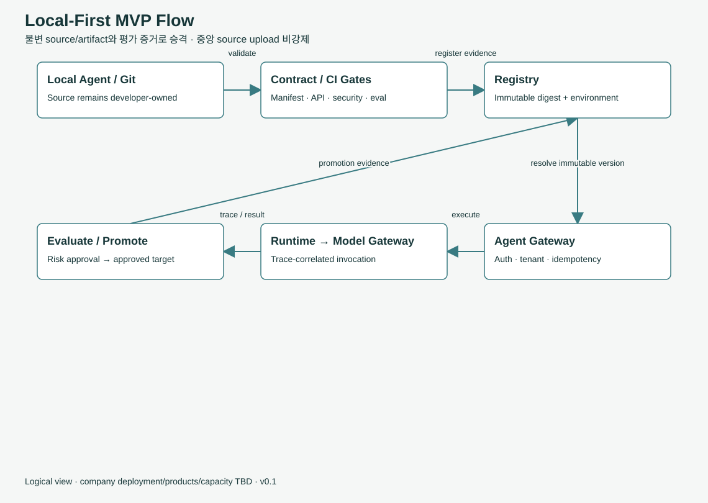

# 수명주기와 프로덕션 승인

> 개발자 가이드 문서입니다. 규범은 [운영·평가](../operating-model.md), [배포 프로파일](../deployment.md), [Durable / HITL](../execution.md) 기술 표준 문서가 기준입니다.

{{journey:10}}

**지금까지** 민준이 지시문 두 문장을 고친 `invoice-summary 1.3.0`이 시험지 `3.0.0`에서 37/40 = 0.925를 받아 승격 후보가 됐습니다. 운영 중인 것은 아직 `1.2.0`입니다.

## 장면

`1.3.0`은 등록됐고 평가도 통과했습니다. 그래도 서연의 요청은 여전히 `1.2.0`이 받습니다. 업무 요청을 받으려면 프로덕션 승인이 필요하기 때문입니다. 민준은 승인에 필요한 근거 여섯 가지를 한 장에 모읍니다. 반복 채점에서 흔들린 두 행도 숨기지 않고 적습니다. 지훈은 그 한 장을 보고, 위험도가 medium이고 읽기 전용인 점을 들어 승인합니다. 그 순간부터 `1.3.0`이 업무 요청을 받습니다.

**{{icon:bulb}} 승인 단계가 없다면** 등록만 하면 곧바로 업무 데이터를 만지게 되고, 무엇을 근거로 올렸는지 나중에 아무도 답하지 못합니다.

## 실물 보기

지훈이 본 `1.3.0`의 승인 기록입니다. 승인 요건 여섯 가지가 한 줄씩입니다.

<!-- kind: example -->

| 승인 요건 | `invoice-summary 1.3.0`의 근거 |
|---|---|
| 불변 버전과 digest | `1.3.0`, revision은 커밋 SHA, 산출물 `sha256:…` |
| 계약 적합성 | Manifest 스키마 검증 통과, 적합성 C1~C11 통과 |
| 보안 검토 | 지시문만 바뀜. 권한, 도구, 데이터 이동은 `1.2.0`과 같음 |
| 평가 결과 | 시험지 `3.0.0`에서 두 지표 모두 37/40 = 0.925(번호 질문 28/28, 거래처명 질문 9/12). 따로 남겨 둔 시험지 18/20 = 0.90 |
| 롤백 검증 | `1.2.0`으로 되돌린 뒤 요청 A가 통과하는 것을 확인 |
| 사람 승인 | 지훈(재무팀장, 예시 역할). 위험도 medium |
| 알려진 한계 | 남은 오답 3행(`row-29`, `row-30`, `row-40`). 3회 채점에서 흔들리는 2행(`row-09`, `row-21`). 다음 개선 대상 |

- 평가 결과 칸에는 전체 점수 하나가 아니라 질문 유형별 점수와 따로 남겨 둔 시험지의 점수를 함께 적습니다.
- "알려진 한계"는 요건이 아니지만 승인자가 무엇을 받아들이는지 알고 승인하게 합니다.

## 잘못되면

**"지시문만 고쳤으니 평가는 건너뛰자"고 하면** 수단 나 같은 수정이 그대로 올라갑니다. 월 누락을 고치려다 번호 질문 6행을 망가뜨린 그 수정입니다([Agent Tuning](19-agent-tuning.md)). 지시문 한 줄도 Agent의 동작을 바꾸므로 새 버전이고, 새 버전은 같은 요건을 모두 거칩니다.

**롤백을 검증하지 않고 올리면** 문제가 생긴 날 되돌리는 방법을 그때 처음 시험하게 됩니다. `1.2.0`으로 실제로 되돌려 보고 요청 A가 통과하는지 확인한 뒤에 올립니다.

## 개발 방식 (Local-First, CLI-First)

**{{icon:cross}} 강제하지 않는 사항 (MUST NOT)**

- 중앙 서버로의 소스 업로드
- 특정 Agent Studio 또는 IDE 사용

**{{icon:check}} 플랫폼 제공 사항**

- 계약 기반 SDK, CLI, 템플릿
- 팀 Git 저장소와 기존 IDE·CLI 환경 유지

실험 단계의 중앙 등록은 선택 사항입니다. **공동 시험이나 프로덕션 승격**이 필요한 시점에 등록합니다.

## 수명주기 단계

<ol class="flow">
<li data-say="내 PC에서 자유롭게 만들고 시험하는 단계입니다. 아직 플랫폼에 등록되지 않았습니다.">{{icon:laptop}}<b>local experiment</b>로컬 개발 및 시험</li>
<li data-say="고정 버전과 Manifest를 Registry에 등록했습니다. 등록은 &#x27;존재를 알렸다&#x27;는 뜻이지 업무에 써도 된다는 뜻은 아닙니다.">{{icon:manifest}}<b>registered</b>불변 버전과 Manifest 등록</li>
<li data-say="형식(JSON Schema)과 API 계약 검증을 통과했습니다.">{{icon:test}}<b>validated</b>JSON Schema·API 계약 검증 통과</li>
<li data-say="평가와 검토를 마쳐 프로덕션 후보가 됐습니다.">{{icon:approve}}<b>eligible</b>평가·검토 완료, 승격 후보</li>
<li data-say="프로덕션 승인을 받아 실제 업무 요청을 처리할 수 있습니다. 이 단계만 업무 트래픽을 받습니다." class="hi">{{icon:rocket}}<b>production-approved</b>프로덕션 승인, 업무 트래픽 처리 가능</li>
<li data-say="더 이상 새로 쓰지 말라고 안내하는 단계입니다. 기존 사용자는 옮겨갈 시간을 가집니다.">{{icon:clock}}<b>deprecated</b>신규 사용 중단 안내</li>
<li data-say="실행을 완전히 종료했습니다. 어느 단계에서든 문제가 발견되면 별도로 격리(quarantined)합니다.">{{icon:cross}}<b>retired</b>실행 종료</li>
</ol>

Registry는 이와 별도로 문제가 확인된 버전을 차단하는 **격리(quarantined)** 상태를 관리합니다.

## 프로덕션 승인 요건 (MUST)

{{icon:lock}}<b>불변 버전과 digest</b>
승격 대상 산출물을 변경 불가능한 참조로 고정합니다.

{{icon:test}}<b>계약 적합성 검증</b>
Manifest의 JSON Schema 검증과 API 계약 검증을 통과합니다.

{{icon:shield}}<b>보안 검토 기록</b>
Identity, 위임, 데이터 이동에 대한 보안 검토를 완료합니다.

{{icon:eye}}<b>평가 결과</b>
데이터셋·Agent·Manifest·정책 버전, 지표, 통과 기준, traceId가 결합된 평가 결과입니다.

{{icon:clock}}<b>롤백 검증 결과</b>
문제 발생 시 이전 버전으로 복구할 수 있음을 검증합니다.

{{icon:approve}}<b>위험도별 사람의 승인</b>
위험도가 높을수록 사람의 승인 단계가 추가됩니다.

**{{icon:bulb}} 핵심 포인트** 셀프서비스가 기본입니다. 자동 검사를 통과하면 팀이 직접 진행하며, 위험도가 높은 경우에만 사람의 승인이 추가됩니다. 코드 외에도 런타임 이미지, 의존성, 도구 descriptor, 모델 라우팅 정책이 변경되면 재평가합니다.

## 배포 프로파일

{{icon:laptop}}<b>local</b>
개발자 장비에서 계약 검증과 합성 데이터 실험을 수행합니다.
프로덕션 승인 대상 아님

{{icon:server}}<b>shared-experiment</b>
등록된 사내·클라우드 자원에서 통합 시험과 평가를 수행합니다.
테넌트 격리 · 사용량 한도 · 감사

{{icon:cloud}}<b>production</b>
승인된 hybrid 실행 환경에서 업무 트래픽을 처리합니다.
보안 · 평가 · 복구 · 위험도별 SLO 근거

**{{icon:warn}} 주의** 등록된 실행 환경은 프로덕션 승인 환경이 아닙니다. 개발자 PC나 Mac mini가 의도치 않게 프로덕션 환경으로 사용되는 것은 이 설계가 방지하려는 위험입니다. SLO는 실행 환경과 업무 위험도에 따라 단계적으로 정의합니다.

멈췄다 이어 하는 실행(Durable, HITL)은 [Agent Runtime과 Memory](11-runtime-memory.md)와 [Agent Tools](15-agent-tools.md)에서, 평가 결과로 Agent를 고치는 흐름은 [Agent Tuning](19-agent-tuning.md)에서 다룹니다.

## 초기 구현 범위: 종단 간 실행 경로

플랫폼은 전체 모듈을 동시에 구현하지 않습니다. 다음 종단 간 실행 경로를 먼저 완성한 뒤, 도구·RAG·Durable 실행·Multi-Agent·분산 실행 환경을 단계적으로 추가합니다.

<ol class="flow">
<li data-say="내 PC의 Agent와 Manifest를 검증합니다.">{{icon:laptop}}<b>로컬 Agent</b>Manifest 검증</li>
<li data-say="Agent Platform APIs로 호출해 인증·신원·정책 검사를 거칩니다.">{{icon:gateway}}<b>Agent Platform APIs</b>인증 · Identity · 정책</li>
<li data-say="Runtime adapter가 Agent를 실행합니다.">{{icon:runtime}}<b>Runtime adapter</b>Agent 실행</li>
<li data-say="Agent Gateway 모델 경로를 거쳐 외부 또는 자체 호스팅 모델을 호출합니다.">{{icon:model}}<b>Agent Gateway 모델 경로</b>외부 · 자체 호스팅 모델</li>
<li data-say="실행 기록과 평가 결과가 승인의 근거로 남습니다.">{{icon:trace}}<b>실행 추적 · 평가</b>검증 근거 기록</li>
<li data-say="Registry와 CI 게이트를 통과하면 승인된 실행 환경으로 승격됩니다.">{{icon:rocket}}<b>Registry · CI 게이트</b>승인된 실행 환경으로 승격</li>
</ol>

## CI 품질 게이트

계약 검증은 문서가 아닌 코드로 강제합니다(Contract-as-Code). CI에서 검사가 하나라도 실패하면 산출물 업로드와 승격을 차단합니다(MUST). 이 패키지는 `scripts/release.py`로 포털 생성, 계약·런타임 테스트, TypeScript 검사, 클라이언트 smoke 테스트, 브라우저 오프라인 검사를 실행합니다. 회사 CI 제품은 TBD입니다.

주요 용어 [Local-First](09-glossary.md#term-local-first) [Registry](09-glossary.md#term-registry) [등록 / 승인 / 배포](09-glossary.md#term-approved) [배포 프로파일](09-glossary.md#term-profile) [Contract-as-Code](09-glossary.md#term-contract-as-code) [Agent Tuning](09-glossary.md#term-tuning) [프로덕션](09-glossary.md#term-production) [승인 검증 근거](09-glossary.md#term-evidence)

## 한 문장으로

등록은 존재를 알리는 일이고, 업무 요청을 받으려면 근거 여섯 가지와 사람의 승인이 필요합니다.

**{{icon:question}} 이해 점검**

Q1. registered 상태의 Agent는 업무 트래픽을 처리할 수 있습니까?

처리할 수 없습니다. 승인 요건을 충족해 production-approved 상태가 되어야 합니다.

Q2. 코드 변경 없이 모델 라우팅 정책만 변경되어도 재평가가 필요합니까?

필요합니다. 런타임 이미지, 의존성, 도구 descriptor, 모델 라우팅 정책의 변경도 재평가 대상입니다.

Q3. 민준이 승인 기록에 "3회 채점에서 흔들리는 2행"을 적었습니다. 적지 않았다면 무엇이 달라지나요?

지훈은 0.925만 보고 승인하게 됩니다. 한계를 적어야 승인자가 무엇을 받아들이는지 알고 결정하고, 다음 개선 대상도 남습니다.

**요약**

- 개발과 실험은 팀이 자율적으로 수행하고, 프로덕션 승격은 6가지 검증 근거로 판단합니다.
- 배포 프로파일은 local, shared-experiment, production 3가지이며, 등록과 승인은 구분됩니다.
- 종단 간 실행 경로를 먼저 완성하고, 기능은 단계적으로 추가합니다.

**{{icon:book}} 근거와 참고 자료**

- 평가 기반 개선과 운영 모니터링: [클라우드 Agent 플랫폼](10-references.md#ref-industry)

