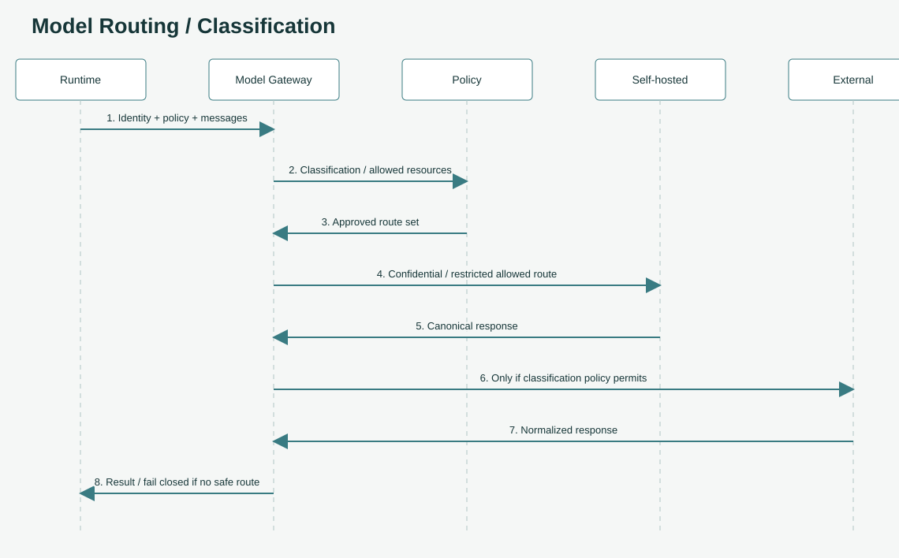

# Agent Gateway

> 개발자 가이드 문서입니다. 규범은 [아키텍처](../architecture.md), [보안 경계](../security.md) 기술 표준 문서가 기준입니다.

{{journey:6}}

<div class="sofar" markdown="1">
**지금까지** 서연의 요청 A에서 `invoice-summary`가 ERP에서 청구서 `INV-2048`을 읽어 왔습니다. 서연의 권한 안에서, 이 호출에만 묶인 lease로 읽었습니다. 이제 읽어 온 내용을 모델에게 주고 요약을 받을 차례입니다.
</div>

## 장면

요약을 만들려는 순간 회사 안 모델이 오류를 냅니다. 민준의 코드에는 재시도가 한 줄도 없는데 서연은 정상 응답을 받습니다. 모든 모델 호출이 반드시 거치는 Agent Gateway가 대신 다시 시도한 덕분입니다. 모델 호출이 지나는 관문이라고 생각하면 됩니다. Agent Gateway는 그 전에 한 가지 일을 더 했는데, 청구서가 기밀이라 회사 밖 모델은 빼고 회사 안 모델로만 보냈습니다. 민준의 코드는 어느 모델로 갈지조차 정하지 않았습니다.

<div class="point" markdown="1">
**{{icon:bulb}} Agent Gateway가 없다면** Agent마다 재시도와 시간 제한을 제각각 넣고, 기밀 데이터가 어느 모델로 나가는지는 각 팀의 코드를 열어 봐야 압니다.
</div>

## 무슨 일이 일어나나

<ol class="flow">
<li data-say="Agent 코드는 모델 주소도 모델 이름도 모릅니다. 플랫폼에 '이 글로 답을 만들어 달라'고만 합니다.">{{icon:runtime}}<b>1. Agent가 모델에 묻는다</b><span>ctx.generate(prompt)</span></li>
<li data-say="Agent Gateway가 데이터 등급을 보고 갈 수 있는 모델을 고릅니다. 기밀은 회사 안 모델로만 갑니다. 보낼 모델이 없으면 다른 모델로 우회하지 않고 실패시킵니다." class="hi">{{icon:gateway}}<b>2. 등급을 보고 모델을 고른다</b><span>모델 경로 · 분류 기반 라우팅</span></li>
<li data-say="모델이 오류를 내거나 응답이 깨지면 Agent Gateway가 남은 시간 안에서 최대 3회까지 다시 시도합니다.">{{icon:clock}}<b>3. 실패하면 Agent Gateway가 다시 시도한다</b><span>최대 3회</span></li>
<li data-say="실패가 이어지면 차단기가 작동해 잠시 모델을 호출하지 않습니다. 장애가 난 모델에 호출이 몰리지 않게 하고, 요청은 바로 실패로 돌려보냅니다.">{{icon:shield}}<b>4. 계속 실패하면 차단기가 작동한다</b><span>차단기 · 호출 한도</span></li>
</ol>

## 실물 보기

Agent 코드에서 모델을 부르는 한 줄입니다. 로컬 예제 `examples/agents/invoice-summary/agent.py`의 실제 코드입니다.

<!-- kind: run boundary: local -->

```python
summary = ctx.generate("Summarize the invoice: " + found)
```

- 모델 이름도, 주소도, 재시도도, 시간 제한도 없습니다. Agent Gateway가 이 호출에 호출자의 신원, 정책 결정, 남은 시간을 붙여 모델 경로로 보냅니다.
- 어느 모델로 갔는지는 응답의 `routeDecisionId`에 남습니다. 요청 A는 `route-self-hosted`, 즉 회사 안 모델입니다.

모델 쪽에 문제가 있을 때 서연의 앱이 받는 응답과 그때 할 일입니다. 참조 구현(`impl/`)의 실제 값입니다.

<!-- kind: run boundary: app -->

| 앱이 받은 응답 | 이 값만으로 알 수 있는 것 | 할 일 |
|---|---|---|
| 429 `RATE_LIMITED`, `Retry-After` 있음 | 초당 호출 한도를 넘음 | 그 시간만큼 기다렸다 다시 |
| 503 `UPSTREAM_UNAVAILABLE`, `Retry-After: 1` 있음 | 차단기가 열림 | 그 시간만큼 기다렸다 다시 |
| 503 `UPSTREAM_UNAVAILABLE`, `Retry-After` 없음 | 모델 쪽으로 가지 못했다는 것까지만 | 잠시 뒤 한 번만 다시. 또 같으면 호출 번호로 운영자에게 확인 |
| 502 `UPSTREAM_ERROR` | Agent Gateway가 3회 시도했지만 모델이 오류 | 사용자에게 알림 |
| 504 `UPSTREAM_TIMEOUT` | 남은 시간 안에 답이 없음 | 사용자에게 알림. 시간을 늘릴지 검토 |

- 본문의 `detail`은 `Model upstream failed`로 같습니다. 앱은 상태 코드와 `code`, `Retry-After`로 판단합니다.
- 셋째 줄이 중요합니다. 연결 실패와 "이 데이터 등급으로 갈 수 있는 모델이 없음"이 앱에는 같은 응답으로 옵니다. 응답 본문만으로 원인을 가릴 수 없으므로 계속 다시 보내지 않습니다.

## 직접 해 보기

<div class="sim" data-sim="model-health"></div>

<ol class="mission">
<li>모델이 한 번만 실패하면 서연은 무엇을 보나요.</li>
<li>앱이 <code>Retry-After</code> 없는 503을 받았습니다. 이 값만으로 무엇을 결정할 수 있나요.</li>
<li>실패가 이어진 뒤 다시 보내면 무엇이 달라지나요. "Agent 코드에 재시도"를 켜고 다시 보세요.</li>
</ol>

<details class="more" markdown="1"><summary>더 해 보기: 데이터 등급에 따라 모델 고르기</summary>

<div class="sim" data-sim="routing"></div>

<ol class="mission">
<li>분류를 <code>confidential</code>로 두고 자체 호스팅 모델을 끄면 어디로 가나요.</li>
<li>호출자가 분류를 낮춰 적으면 어떻게 되나요.</li>
</ol>

<div class="lanes">
<div class="lane" data-say="공개(public)나 사내(internal) 데이터는 정책이 허용하면 외부 모델과 자체 호스팅 모델 중 어느 쪽으로도 갈 수 있습니다."><div>{{icon:shield}} <code>public</code> · <code>internal</code></div><i>&#8594;</i><div class="gate">{{icon:model}}<span>모델 경로<small>정책 허용 시</small></span></div><i>&#8594;</i><div>{{icon:cloud}} 외부 또는 자체 호스팅 모델</div></div>
<div class="lane" data-say="기밀(confidential)이나 제한(restricted) 데이터는 외부 모델로 가는 길을 막고, 회사 안에서 운영하는 자체 호스팅 모델로만 보냅니다."><div>{{icon:lock}} <code>confidential</code> · <code>restricted</code></div><i>&#8594;</i><div class="gate">{{icon:model}}<span>모델 경로<small>외부 경로 거부</small></span></div><i>&#8594;</i><div>{{icon:server}} 자체 호스팅 모델</div></div>
<div class="lane" data-say="갈 수 있는 모델이 하나도 없으면 다른 길로 몰래 돌아가지 않고 요청을 실패시킵니다. 이것을 실패 시 거부(fail closed)라고 합니다."><div>{{icon:warn}} 허용 경로 없음</div><i>&#8594;</i><div class="gate">{{icon:model}}<span>모델 경로<small>우회 없음</small></span></div><i>&#8594;</i><div>{{icon:cross}} 요청 실패</div></div>
</div>


</details>

## 잘못되면

**모델 응답이 늦으면** 서연의 요청 A는 남은 시간이 지나는 순간 504 `UPSTREAM_TIMEOUT`을 받습니다. 시간 초과는 다시 해도 남은 시간이 없으므로 Agent Gateway가 다시 시도하지 않습니다. 앱이 요청에 준 시간(`timeoutMs`)이 Agent Gateway가 기다리는 한도가 됩니다. 사용자에게 "지금은 요약을 만들 수 없다"고 알리고, 자주 일어나면 시간을 늘릴지 검토합니다.

**모델 장애가 이어지는데 요청이 계속 들어오면** 요청 3건이 연속으로 실패한 뒤 차단기가 작동해 open 상태가 됩니다. 그 뒤 1초 동안은 모델을 호출하지 않고 바로 503과 `Retry-After: 1`을 돌려줍니다. 1초 뒤 half-open 상태에서 시험 호출 하나가 성공하면 closed 상태로 돌아가 요청을 다시 모델로 보냅니다. 앱은 `Retry-After`만큼 기다렸다 다시 보냅니다.

<details class="more" markdown="1"><summary>더 보기: 갈 모델이 없을 때, 분류를 낮춰 적을 때, 재시도를 직접 넣을 때</summary>

**기밀 데이터인데 쓸 수 있는 모델이 외부 모델뿐이면** Agent Gateway는 외부 모델로 우회하지 않고 503으로 실패시킵니다. 모델 경로를 직접 호출해 보면 이유가 구분되어 보입니다.

<!-- kind: run boundary: route -->

```json
{"status": 503, "code": "UPSTREAM_UNAVAILABLE", "detail": "No policy-approved model route"}
```

참조 구현 S1 `confidential-external-only`의 값입니다. 이 문구는 앱까지 전해지지 않고 `Model upstream failed`로 바뀝니다. 그래서 앱 개발자는 위 표의 셋째 줄처럼 다룹니다.

**호출자가 요청에 분류를 낮춰 적어도** Agent Gateway는 플랫폼이 아는 분류와 비교해 더 높은 쪽을 씁니다. 높여 적는 것은 받아들이고 낮춰 적는 것은 무시합니다(적합성 C7, 참조 구현 S1 `downgrade-classification`).

**1초에 5회를 넘겨 부르면** 여섯 번째 요청부터 429 `RATE_LIMITED`와 `Retry-After`를 받습니다. 한도는 테넌트와 Agent별입니다.

**민준이 Agent 코드에 재시도 3회를 직접 넣으면** Agent Gateway의 재시도 3회와 곱해져 모델을 최대 9번 호출합니다. 이미 장애가 난 모델에 부하가 더 몰리고 서연은 더 오래 기다립니다. 모델 호출의 재시도는 Agent Gateway에 맡깁니다.
</details>

## 내가 할 일

1. 모델 호출에 재시도를 직접 넣지 않습니다. `ctx.generate`만 부릅니다.
2. 앱은 요청에 남은 시간(`execution.timeoutMs`)을 줍니다.
3. 앱은 위 표대로 응답을 처리합니다. `Retry-After`가 있으면 그만큼 기다리고, 없으면 계속 다시 보내지 않습니다.
4. 문의할 때는 호출 번호(`invocationId`)를 함께 전달합니다.

**내 PC에서 해 보기** ZIP만 받았어도 되는 것은 둘입니다. 응답의 `routeDecisionId`가 `route-self-hosted`인지 보는 것([Agent Tools](15-agent-tools.md)의 응답)과, 적합성 C7입니다.

<!-- kind: run boundary: local -->

```text
PASS  C7   platform-enforcement  Classification downgrade  caller cannot downgrade classification; external route unused
```

저장소가 있으면 `make scenarios`의 S2, S3, S4 줄에서 위 표의 응답을 하나씩 확인합니다(PostgreSQL이 필요합니다).

<div class="scope" markdown="1">
**제공 범위 (v0.1)**

| 항목 | 등급 | 확인하는 곳 |
|---|---|---|
| 분류 기반 모델 경로 선택, 낮춘 분류 무시 | 실행 | 로컬 mock, 적합성 C7 |
| 시간 초과, 재시도, 차단기, 호출 한도 | 실행 | 참조 구현 S2·S3·S4 |
| 토큰·비용 한도와 비용 귀속 | 정의 | 수치는 회사 결정(TBD) |
</div>

## 규칙으로 정리

- 모델과 도구로 나가는 호출은 모두 Agent Gateway를 지납니다. Agent가 모델 공급사를 직접 부르지 않습니다(MUST NOT). 장면 ⑥
- 모델 경로는 데이터 분류와 정책으로 정합니다. 허용된 경로가 없으면 우회하지 않고 실패시킵니다(MUST, fail closed). 장면 ⑥
- 호출자가 적은 분류는 주장일 뿐입니다. 높일 수는 있어도 낮출 수는 없습니다(MUST).
- 라우팅 결정은 `routeDecisionId`로 기록합니다(MUST).
- Agent Gateway는 모든 호출이 거치는 계층이므로 시간 제한, 재시도, 차단기, 호출 한도를 스스로 갖습니다.

<div class="terms" markdown="1">
<span class="label">주요 용어</span> [Agent Gateway](09-glossary.md#term-agent-gateway) [모델 경로](09-glossary.md#term-model-gateway) [데이터 분류](09-glossary.md#term-classification) [fail closed](09-glossary.md#term-fail-closed) [routeDecisionId](09-glossary.md#term-route-decision) [차단기](09-glossary.md#term-circuit-breaker) [Problem Details](09-glossary.md#term-problem)
</div>

## 한 문장으로

모든 모델 호출이 거치는 계층으로, 어느 모델로 보낼지 정하고 모델 장애에는 재시도, 차단기, 호출 한도로 대응합니다.

<div class="check" markdown="1">
**{{icon:question}} 이해 점검**

<details markdown="1"><summary>Q1. 앱이 503과 Model upstream failed를 받았고 Retry-After가 없습니다. 이 값만으로 어떤 조치를 정할 수 있나요?</summary>
잠시 뒤 한 번만 다시 보내는 것까지 정할 수 있습니다. 연결 실패인지 이 등급으로 갈 모델이 없는 것인지는 이 응답으로 가릴 수 없으므로, 또 같으면 호출 번호로 운영자에게 확인합니다.
</details>

<details markdown="1"><summary>Q2. 민준의 코드에 재시도가 없는데 모델이 한 번 실패한 요청이 성공했습니다. 누가 무엇을 했나요?</summary>
Agent Gateway의 모델 경로가 남은 시간 안에서 다시 시도했습니다. 서연의 앱은 200 하나만 받습니다.
</details>

<details markdown="1"><summary>Q3. 기밀 청구서를 다루는 요청인데 회사 안 모델이 내려가 있고 외부 모델은 살아 있습니다. 어떻게 되나요?</summary>
요청이 실패합니다. 기밀 데이터는 외부 모델로 보낼 수 없고, Agent Gateway는 다른 모델로 우회하지 않습니다.
</details>
</div>

<div class="refs" markdown="1">
**{{icon:book}} 근거와 참고 자료**

- Gateway 구조: [Gateway 패턴](10-references.md#ref-gateway)
</div>

다음 장면은 ⑦입니다. 서연이 요약을 부탁한 청구서 비고란에 누군가 지시문을 숨겨 놓았습니다.
